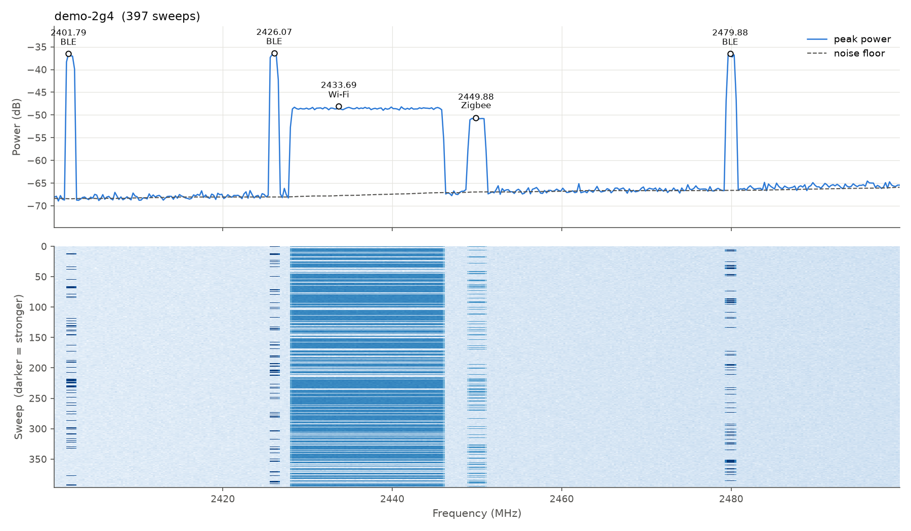
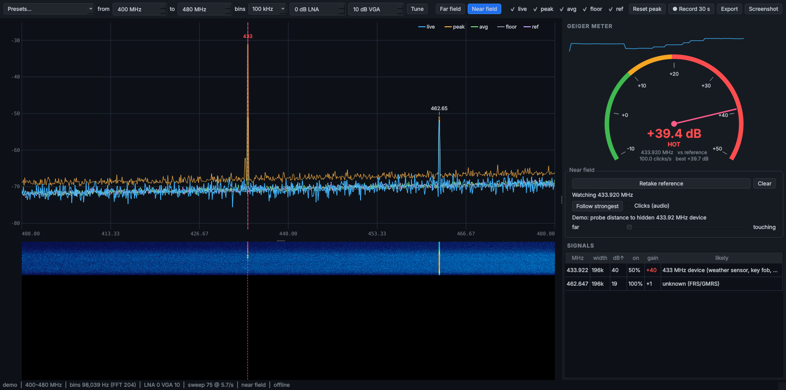
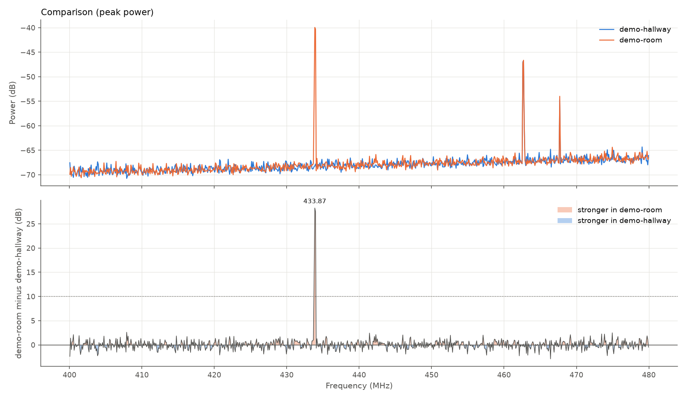
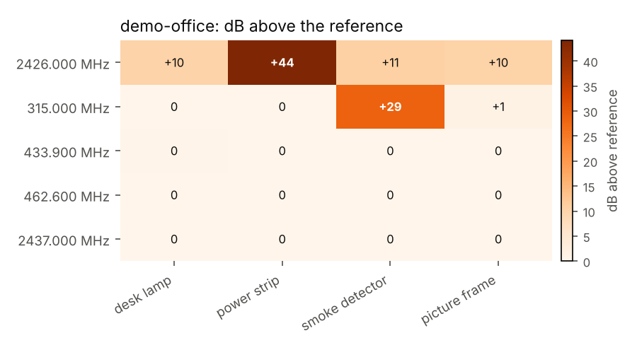
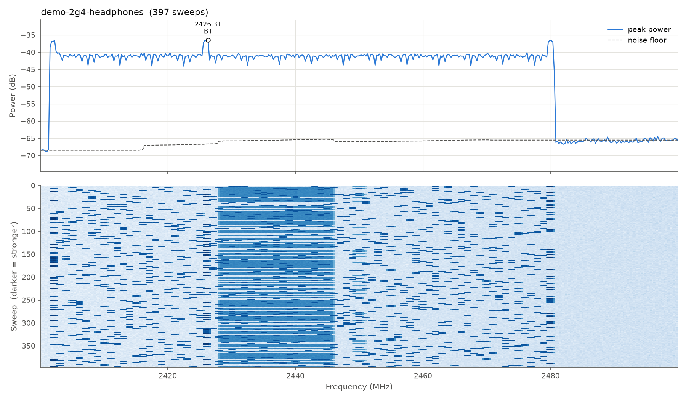

# rfscoper

[](https://github.com/su-daedalus/rfscoper/actions/workflows/ci.yml)

[](LICENSE)

**Capture, analyze, compare, identify and locate radio signals with a HackRF: a live desktop scope for far-field and near-field work, plus a command-line toolkit.**

`hackrf_sweep` scans the radio spectrum from 1 MHz to 6 GHz in under a second,
but it only prints raw CSV. rfscoper turns that output into answers: which
signals are present, how often they transmit, **what they probably are**, and
what changed between two places or two points in time.



```text
$ rfscoper show demo-2g4
       MHz      width  above floor   on  likely
  2426.071   1.19 MHz         31.7  14%  Bluetooth Low Energy advertising
  2480.000  1.429 MHz         30.1  14%  Bluetooth Low Energy advertising
  2402.024   1.19 MHz         31.9  13%  Bluetooth Low Energy advertising
  2437.024  18.33 MHz         19.7  72%  Wi-Fi (2.4 GHz)
  2450.000  1.905 MHz         16.3  20%  Zigbee / Thread / Matter (smart home)
```

## Why

A spectrum analyzer tells you what is on the air *right now*. The interesting
questions are usually comparative: What is in this room that is not in the
hallway? What appeared since yesterday? Which signals are always on, and which
come and go? And what *is* that thing at 2426 MHz?

rfscoper is built around those questions. Every capture is saved with its
settings so it can be compared fairly later, every signal gets an explained
best guess, and every analysis can be exported as JSON.

## Features

- **A live scope window** (`rfscoper scope`): a real-time spectrum with
  live, peak-hold, average, noise-floor and reference traces, a waterfall, a
  Geiger-counter meter with optional audio clicks, and a table of identified
  signals. Tune it like SDR++: presets, click to watch a frequency, scroll to
  zoom. Far-field and near-field modes. Fully offline: it never touches the
  network.
- **Timed or counted captures.** Sweep for a set number of passes or for a set
  duration (`--duration 60`), with `hackrf_sweep` stopped cleanly either way.
- **An accurate record of every capture.** What you asked for, what
  `hackrf_sweep` actually did with it (it rounds bin widths, ranges and gains),
  and what the file contains, with start and finish times to the millisecond.
- **Signal detection** against a noise floor estimated two ways, across
  frequency and across time, so both steady stations and hopping devices are found.
- **Signal identification.** Each signal is matched against a catalog of 47
  common US signal types by frequency, channel, width and behavior, with a
  confidence score and the reasoning behind it (`--explain`).
- **Bluetooth Low Energy vs. Classic Bluetooth.** BLE advertising sits on three
  fixed channels; Classic hops across the whole band. rfscoper tells them apart.
- **Duty cycle.** How often each signal is on: steady transmitter or intermittent.
- **Strength and proximity hints.** A strong signal from a low-power device
  (a phone, a tracker, a key fob) is flagged as probably close by.
- **Comparison** of 2 to 4 captures on a shared frequency axis, with a
  difference panel and an identified list of what is new.
- **Near-field probing.** With a small loop antenna held against objects,
  `rfscoper probe` finds *where* a signal comes from: a reference capture, a
  capture per object, and a report of which objects are hot, plus a live
  meter for hunting by hand.
- **Spectrum and waterfall plots**, with signals labeled.
- **JSON output** on every analysis command, and a Python library API.
- **No hardware needed to try it**: ships with realistic demo captures.

## Requirements

- Linux or macOS, Python 3.10 or newer
- A HackRF and the `hackrf` host tools, which provide `hackrf_sweep` (needed only
  for live use; everything else works on saved captures and demos)
- For the scope window: Qt through PyQt6 or PyQt5 (see below)

## Install

```bash
git clone https://github.com/su-daedalus/rfscoper.git
cd rfscoper
python3 -m venv .venv
source .venv/bin/activate
pip install -e .
```

### The scope window needs Qt

On a Raspberry Pi, DragonOS or any Debian/Ubuntu system, the simplest route is
the system's PyQt5 (GNU Radio usually brought it in already). Make the venv
able to see it:

```bash
sudo apt install python3-pyqt5
deactivate; rm -rf .venv
python3 -m venv --system-site-packages .venv
source .venv/bin/activate
pip install -e .
```

Or install PyQt6 from prebuilt wheels into the venv (about 100 MB):

```bash
pip install -e ".[app]"
```

Then `rfscoper scope --install-launcher` adds an **rfscoper scope** entry to
your desktop's application menu.

## Try it in 30 seconds (no HackRF)

```bash
python examples/make_demo_data.py
rfscoper show demo-2g4 --explain          # Wi-Fi, BLE and Zigbee, with reasoning
rfscoper show demo-2g4-headphones         # Classic Bluetooth audio hopping
rfscoper info demo-2g4                    # how a capture was taken
rfscoper probe report demo-office         # which objects a hidden transmitter is in
rfscoper compare demo-hallway demo-room   # what is new in the room?
rfscoper scope --demo                     # the live window, with a simulated radio
rfscoper scope --demo --near --range 400:480   # hunt the demo's hidden transmitter
```

The demo captures are simulated, and say so in their notes. The screenshots in
this README come from them.

## Usage

### 0. Watch live: the scope window



```bash
rfscoper scope                                  # 300-500 MHz, far field
rfscoper scope --range 2400:2500 --bin 100k     # Wi-Fi, Bluetooth, Zigbee
rfscoper scope --near --range 400:480 --lna 0 --vga 10 --watch 433.92M   # with a probe
```

The window streams `hackrf_sweep` and redraws about 8 times a second:

- **Spectrum**: live (blue), peak hold (orange), average (green), noise floor
  (gray) and, in near-field mode, the reference (purple). Detected signals are
  marked. Hover for a readout, **click** to watch a frequency, **scroll** to
  zoom in or out around the cursor (the radio retunes).
- **Waterfall**: the last few hundred sweeps, newest at the top.
- **Geiger meter**: the level at the watched frequency (or the strongest
  signal) above the noise floor, or above the reference in near-field mode.
  Green is background, orange is warm (10 dB), red is HOT (20 dB). The needle
  moves like a real meter, the strip above it shows the last 15 seconds, and
  **Clicks** plays Geiger-style audio that speeds up as the level rises, so you
  can sweep a wall without looking at the screen.
- **Signals table**: frequency, width, dB above the floor, duty cycle, gain over
  the reference, and the identification from the catalog. Click a row to watch
  it.
- **Toolbar**: band presets (FM, airband, UHF, 915 ISM, cellular, 2.4 and
  5.8 GHz, near-field), range, bin width, LNA/VGA gains, trace toggles,
  **Record 30 s** (saved as a normal capture that `show`, `compare` and `info`
  read), **Export** (the traces as CSV) and **Screenshot**.

**Far field vs. near field.** Far-field mode is the spectrum analyzer: what is
on the air, measured against the noise floor. In near-field mode you fit a
loop probe, hold it in open air, press **Take reference**, then move it over
objects: the meter and the gain column now show how much stronger each signal
is than in open air, which is what says *where* it comes from. **Follow
strongest** lets the meter follow whichever signal is loudest.

The scope runs entirely on your machine. It never opens a network
connection, needs no browser, and works with networking switched off. The RF
amp is never enabled from the scope, to protect the HackRF's input when a
probe and preamp are fitted.

### 1. Capture

```bash
# 30 sweeps (the default)
rfscoper capture hallway --range 400:480 --bin 100k --note "hallway baseline"

# or capture for a set time
rfscoper capture room --range 2400:2500 --bin 250k --duration 60 --note "center of the room"
```

If a capture with that name already exists, rfscoper asks whether to
overwrite it. Answer no and the new one is saved as the next in the series
(`room-capture2`, `room-capture3`, ...), so nothing is lost. `--overwrite`
replaces without asking. An overwrite only removes the old capture once the
new one has succeeded. `probe start` works the same way for sessions.

Captures land in `~/rfscoper-captures/` as `NAME.csv` plus `NAME.meta.json`,
**outside the project folder on purpose**: they record what was transmitting
where you stood, so they're kept where git can never pick them up. Set
`RFSCOPER_DIR` or pass `--dir` to use another folder. Add
`--dry-run` to see the `hackrf_sweep` command and what it will really do:

```text
hackrf_sweep -f 2400:2490 -w 250000 -l 24 -g 20 -r /home/you/rfscoper-captures/room.csv   # stopped after 60 s
hackrf_sweep will cover 2400-2500 MHz with 238,095.24 Hz bins (FFT size 84), for 60 s
  adjusted: bin width 250,000 Hz -> 238,095.24 Hz (hackrf_sweep uses FFT sizes of the form 8k+4; 84 here)
  adjusted: range 2400-2490 MHz -> 2400-2500 MHz (hackrf_sweep covers whole 20 MHz steps)
```

`hackrf_sweep` adjusts some requests, and rfscoper tells you before it starts:

- **Bin width.** It samples at 20 MHz and uses FFT sizes of the form 8k+4
  (4, 12, 20 … 84 … 204 …), so the bin width is 20 MHz divided by one of those.
  `--bin 250k` becomes 238.1 kHz and `--bin 100k` becomes 98.04 kHz.
  `--bin 1M`, `--bin 200k` and `--bin 40k` come out exact. The limits are 2445 Hz to 5 MHz.
- **Range.** It covers whole 20 MHz steps from the start frequency, so `2400:2490` covers 2400-2500.
- **Gains.** LNA goes in steps of 8 dB and VGA in steps of 2 dB; other values round down.

| Option | Default | Meaning |
|---|---|---|
| `--range START:STOP` | `1:6000` | Frequency range in MHz |
| `--bin` | `1M` | Bin width (`100k`, `1M`, ...). Smaller is finer and slower |
| `--sweeps` | `30` | Number of passes over the range |
| `--duration SECONDS` | | Capture for a set time instead of a number of sweeps |
| `--lna` / `--vga` | `24` / `20` | Receiver gains in dB |
| `--amp` | off | RF amplifier |
| `--note` | | Free text saved with the capture |

To compare two captures fairly, take them with the same range, bin width and gains.

### Check how a capture was taken

```text
$ rfscoper info demo-2g4
demo-2g4  (/home/you/rfscoper-captures/demo-2g4.csv)
  note      SIMULATED demo data: 2.4 GHz: Wi-Fi, BLE, Zigbee
  started   2026-01-01T12:03:00.000+00:00
  finished  2026-01-01T12:03:59.992+00:00
  file      first row 2026-01-01 12:03:00.000000, last row 2026-01-01 12:03:59.992436

             requested      radio used     file contains
  range      2400-2500 MHz  2400-2500 MHz  2400.00-2500.00 MHz
  bin width  250,000.00 Hz  238,095.24 Hz  238,095.24 Hz
  FFT size   -              84             84
  length     60 s           until stopped  59.992 s (6.6/s)
  sweeps     -              -              396 complete + 1 partial
  gains      24 / 20 dB     24 / 20 dB     -
  data       -              -              7932 rows, 420 bins

  command   hackrf_sweep -f 2400:2500 -w 250000 -l 24 -g 20 -r /home/you/rfscoper-captures/demo-2g4.csv   # simulated, not run
  adjusted  bin width 250,000 Hz -> 238,095.24 Hz (hackrf_sweep uses FFT sizes of the form 8k+4; 84 here)
```

Every capture's record keeps three views, because they differ: what you
**requested**, what the **radio used** after `hackrf_sweep`'s own rounding, and
what the **file contains**, read back from the CSV. `info` works on captures
from older versions too, rebuilding the last two from the request and the file.

### 2. Analyze and identify

```text
$ rfscoper show demo-room
demo-room: 30 sweeps, 816 bins of 98.04 kHz (FFT 204), 400.0-480.0 MHz, 4.5 s (6.6 sweeps/s)
Typical noise floor: -68.7 dB

Signals at least 10 dB above the noise floor (peak):
      MHz      width  above floor    on  likely
  433.873  294.1 kHz         29.0   37%  433 MHz device (weather sensor, key fob, doorbell)
  462.647  196.1 kHz         21.1  100%  unknown (FRS/GMRS)
  467.696  98.04 kHz         13.6   30%  FRS/GMRS walkie-talkie
```

- `width` is the occupied bandwidth, measured where the signal crosses the threshold.
- `on` is the duty cycle: the share of sweeps in which the signal was present.
- `likely` is the best guess. A `?` after it means "possible" rather than
  "likely". `unknown` means nothing in the catalog fits well: the signal at
  462.647 MHz sits in the walkie-talkie band, but it is far too wide and too
  steady to be one, so rfscoper won't call it that. The one at 467.696 MHz,
  intermittent and on an FRS channel, is.

Add `--explain` to see why:

```text
2426.071 MHz | 1.19 MHz wide | strong | on 14%
  likely    1.00  Bluetooth Low Energy advertising
                  + in the 2.4 GHz ISM band
                  + on a BLE channel (2426 MHz)
                  + about 1.19 MHz wide, as expected (500 kHz-1.5 MHz)
                  + on in 14% of sweeps: intermittent, as expected
                  note: BLE devices announce themselves on exactly three channels ...
  unlikely  0.40  Wi-Fi (2.4 GHz)
  hint: strong for a low-power device: probably close by
```

### 3. Compare captures

```text
$ rfscoper compare demo-hallway demo-room
Stronger in demo-room than in demo-hallway by 10+ dB:
      MHz      width  vs demo-hallway   on  likely
  433.873  294.1 kHz             28.3  37%  433 MHz device (weather sensor, key fob, doorbell)
```

The first capture is the baseline. With exactly two captures the plot adds a
difference panel; with three or four, each is compared against the baseline.



### 4. Find where a signal comes from

Fit a small loop antenna (a near-field probe) instead of the whip, take a
reference capture in open air, then one capture with the probe held against
each object you want to check:

```bash
rfscoper probe start office                 # reference: probe mid-room, open air
rfscoper probe spot office "desk lamp"
rfscoper probe spot office "power strip"
rfscoper probe spot office "smoke detector"
rfscoper probe report office
```

```text
       MHz  ref dB  +desk lamp  +power strip  +smoke detect  +picture fram  verdict                                    likely
  2426.000   -64.8         +10           +44            +11            +10  HOT at power strip (+44 dB)                Bluetooth Low Energy advertising
   315.000   -69.0           0             0            +29             +1  HOT at smoke detector (+29 dB)             315 MHz device (key fob, garage remote, tire sensor)
   433.900   -57.6           0             0              0              0  same everywhere: not from any probed spot  433 MHz device (weather sensor, key fob, doorbell)
   462.600   -52.0           0             0              0              0  same everywhere: not from any probed spot  unknown (FRS/GMRS)
  2437.000   -53.9           0             0              0              0  same everywhere: not from any probed spot  Wi-Fi (2.4 GHz)
```

Close to a small transmitter the field falls off steeply with distance, so a
signal 20 dB or more stronger at one object than in open air is coming from
that object. A signal that reads the same everywhere is distant, however
strong it is. For hunting rather than surveying, `rfscoper probe live --watch
433.92M` prints a bar per sweep as you move the probe.



[`docs/near-field-probe.md`](docs/near-field-probe.md) covers buying or
building the probe, protecting the HackRF's input, and the full method.

### 5. Explore the catalog

```bash
rfscoper catalog                  # every signal type rfscoper knows
rfscoper catalog bluetooth        # search it
rfscoper identify 2426 --width 1M --duty 0.3 --bin 250k   # "what could this be?"
```

`identify` runs the same reasoning on numbers you type in, which is handy for
signals you saw in SDR++ or GQRX.

### Options for `show` and `compare`

| Option | Default | Meaning |
|---|---|---|
| `--stat peak\|mean` | `peak` | Peak hold catches brief signals; mean shows typical levels |
| `--threshold DB` | `10` | Detection threshold above the noise floor (`show`) or the baseline (`compare`) |
| `--on-level DB` | `6` | Level above the noise that counts as "on" for the duty cycle |
| `--explain` | | Print the reasoning behind each identification |
| `--top N` | `15` | Maximum number of signals to report |
| `--out FILE` | next to the capture | Where to save the PNG |
| `--no-plot` | | Skip the PNG |
| `--json` | | Print JSON to stdout; status messages go to stderr |

## Bluetooth: Low Energy vs. Classic

The two kinds of Bluetooth share the 2.4 GHz band but use it very differently,
and that difference is visible in a sweep.

| | BLE advertising | Classic Bluetooth (BR/EDR) |
|---|---|---|
| Typical devices | Phones, trackers, watches, beacons, earbuds' pairing | Headphones and speakers playing audio, car kits |
| Channels | Only 3: 2402, 2426 and 2480 MHz | 79 channels, 1 MHz apart, 2402-2480 MHz |
| Behavior | Short bursts on the same three channels | Hops 1,600 times per second across all 79 |
| In peak hold | Three narrow 1 MHz spikes | An ~80 MHz "carpet" across the whole band |



A hopping carpet hides narrower signals in peak hold. The mean, where each hop
barely registers, sees through it to anything that is on most of the time,
like the Wi-Fi underneath:

```text
$ rfscoper show demo-2g4-headphones --stat mean
       MHz     width  above floor   on  likely
  2436.905  18.1 MHz         15.2  74%  Wi-Fi (2.4 GHz)
```

BLE advertising doesn't survive the mean either: its bursts are too brief. To see
BLE devices in a room with Bluetooth audio playing, pause the music for a
minute, or `compare` against a capture taken with the headphones off.

**What a sweep cannot tell.** A BLE *connection* (as opposed to advertising)
also hops, over 37 data channels, and in a sweep it looks much like Classic
Bluetooth. rfscoper reports both as "Bluetooth, hopping" rather than guess.

**Tip:** BLE advertising bursts last a fraction of a millisecond, so peak hold
needs time to catch them. Capture the 2.4 GHz band for a minute:

```bash
rfscoper capture ble --range 2400:2500 --bin 250k --duration 60
rfscoper show ble --explain
```

## JSON for scripting

```bash
# Everything identified as Bluetooth, with its confidence
rfscoper show room --json --no-plot \
  | jq '.signals[] | {mhz: (.center_hz/1e6), guess: .likely[0].name, label: .likely[0].label}'

# Strong low-power devices: probably in the room
rfscoper show room --json --no-plot | jq '.signals[] | select(.hint != null and (.hint | test("close")))'
```

## Use it as a library

```python
from pathlib import Path

from rfscoper import load_sweeps
from rfscoper.analysis import bin_width, duty_cycles, find_peaks, signal_floor, spectrum
from rfscoper.identify import identify

data = load_sweeps(Path.home() / "rfscoper-captures/room.csv")  # sweeps x frequency bins
peak = spectrum(data, "peak")
signals = find_peaks(data.freqs_hz, peak, signal_floor(data), threshold_db=10)

for signal, on in zip(signals, duty_cycles(data, signals)):
    best = identify(signal.center_hz, signal.width_hz, bin_width(data.freqs_hz), on)[0]
    print(signal.center_hz / 1e6, best.kind.name, best.label)
```

See [`examples/quickstart.py`](examples/quickstart.py) for a complete script, and
[`docs/how-sweeps-work.md`](docs/how-sweeps-work.md) for a guided tour of the code.

## How it works

1. **Parsing.** `hackrf_sweep` writes one 5 MHz slice of spectrum per CSV row,
   not necessarily in frequency order. rfscoper regroups the rows into full
   sweeps and builds a matrix: one row per sweep, one column per frequency bin.
2. **Peak vs. mean.** Collapsing the matrix down each column gives one value per
   frequency. Peak hold keeps the strongest value ever seen, so a signal that
   transmitted once still shows up. The mean shows what each bin usually looks like.
3. **Noise floor, two ways.** Across frequency: a rolling low percentile over
   ~60 MHz of neighboring bins, which ignores the bins signals occupy. Across
   time: each bin's quietest sweeps, which see under anything that isn't on
   all the time, including hopping signals that fill the whole band. Each is
   blind where the other sees, so rfscoper takes the lower of the two.
4. **Detection.** Bins that rise past the floor by the threshold are grouped
   into runs. Each run is one signal, with a center, a width and a strongest bin.
5. **Duty cycle.** For each signal, the share of sweeps in which it stood at
   least `--on-level` dB above the noise.
6. **Identification.** Each catalog entry covering the signal's frequency starts
   with a base score; then the channel, width and behavior checks add or
   remove points. Checks only count when the sweep can measure them: 1 MHz bins
   cannot measure a 200 kHz FM station, so its width counts neither way.
7. **Comparison.** The second capture is interpolated onto the first one's bins
   over the range they share, then subtracted.
8. **Timed captures.** Without `-N`, `hackrf_sweep` runs until interrupted.
   rfscoper starts it, waits for the requested duration, and sends SIGINT, the
   same signal as Ctrl+C, which `hackrf_sweep` handles by closing the CSV cleanly.

## Project layout

```text
src/rfscoper/
├── parser.py     hackrf_sweep CSV -> sweeps x bins matrix
├── analysis.py   peak/mean, noise floors, detection, duty cycle, comparison
├── bands.py      the signal catalog: a dictionary of 47 US signal types
├── identify.py   scores catalog entries against a detected signal
├── plots.py      spectrum, waterfall and comparison plots
├── capture.py    runs hackrf_sweep, models its rounding rules, records
│                 requested / radio used / file contents
├── probe.py      near-field sessions, hotspot analysis, live meter
├── live.py       streaming engine: sources (HackRF, demo), live state, meter
├── app.py        the scope window: spectrum, waterfall, Geiger meter, table
├── qt.py         runs on PyQt6 or PyQt5, whichever is installed
├── clicks.py     Geiger-counter audio through aplay/pacat
└── cli.py        the rfscoper command
tests/            pytest suite, no hardware needed
examples/         demo data generator and library example
docs/             code walkthrough and publishing notes
```

## Development

```bash
pip install -e ".[dev]"
pytest --cov                          # tests and coverage
ruff check . && ruff format --check . # lint and formatting
mypy                                  # type checks
```

GitHub Actions runs all of this on Python 3.10 through 3.14 for every push.
Adding a signal type is a matter of adding one entry to `CATALOG` in
`bands.py`; the tests check every entry for consistency.

## Roadmap

- Alerts in the scope when a new signal appears
- Context-aware identification (three spikes on 2402/2426/2480 confirm each other as BLE)
- HTML report with embedded plots for a set of captures
- Catalogs for other regions

## Limitations

- **Identification is an educated guess from a signal's shape, not proof.** A
  sweep measures power only; it never decodes what a signal says. Anything can
  transmit on any frequency, and the catalog covers common signals, not all of them.
- Power is relative dB from the HackRF's FFT, not calibrated dBm. Compare
  captures taken with the same gain settings. Strength hints depend on your
  antenna and gains.
- Bandwidth can only be measured down to the bin width. Use finer bins
  (`--bin 100k` or less) to tell narrow signals apart.
- Brief transmissions are caught by chance. Longer captures catch more.
- A quiet spectrum does not prove nothing is there: devices can record without
  transmitting, or transmit rarely.

## Responsible use

rfscoper only receives, and it only measures signal power: it never demodulates
or decodes what a transmission says. When probing, keep the RF amplifier off
and the gain low: the HackRF One's input limit is -5 dBm, and a probe pressed
against a transmitting antenna can reach it. Laws on receiving and recording radio
signals vary by country, so check the rules where you live. Captures record
what was transmitting around you and your notes about the place, which is why
the `.gitignore` keeps them out of the repository. See [SECURITY.md](SECURITY.md)
for the privacy details and how to report a vulnerability.

## License

[MIT](LICENSE)
